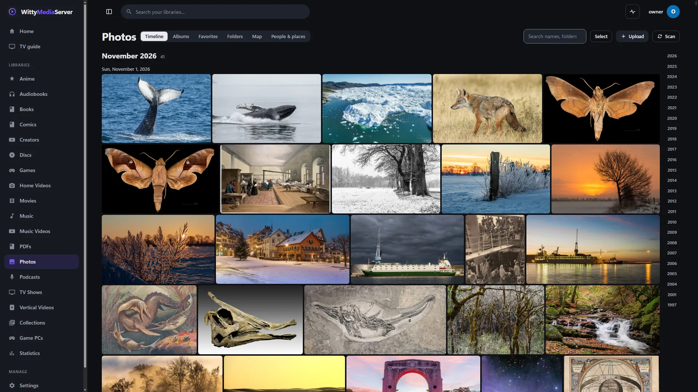
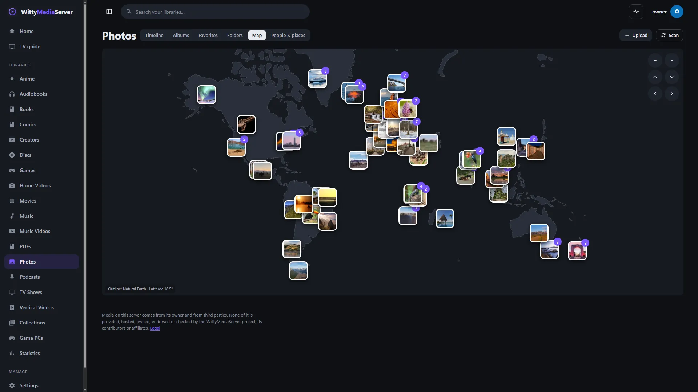
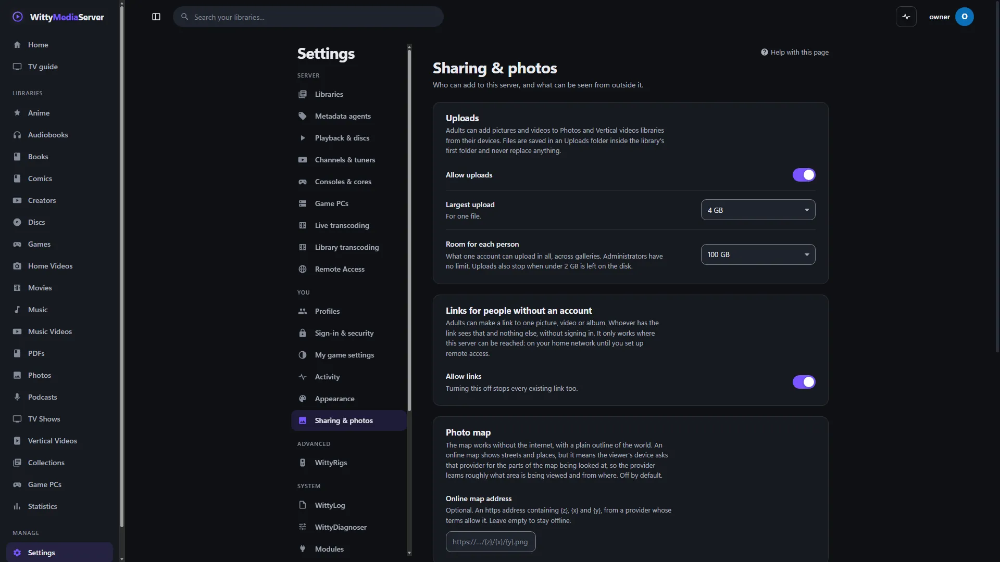

# WittyPhotos

Reads what a photo says about itself, without decoding the picture: when it was taken, with what camera, where, and how big it is. WittyMediaServer's photo libraries use it, and you need it if you have one.

<!-- pictures -->



<sub>The timeline in WittyMediaServer, with pictures from [Wikimedia Commons](https://commons.wikimedia.org/), under CC BY, CC BY-SA, CC0 or in the public domain; the server's [credits list](https://github.com/wittywilla/WittyMediaServer/blob/master/docs/images/CREDITS.md) names each.</sub>


<sub>The viewer, with pictures from [Wikimedia Commons](https://commons.wikimedia.org/), under CC BY, CC BY-SA, CC0 or in the public domain; the server's [credits list](https://github.com/wittywilla/WittyMediaServer/blob/master/docs/images/CREDITS.md) names each.</sub>



<sub>The map, with pictures from [Wikimedia Commons](https://commons.wikimedia.org/), under CC BY, CC BY-SA, CC0 or in the public domain; the server's [credits list](https://github.com/wittywilla/WittyMediaServer/blob/master/docs/images/CREDITS.md) names each.</sub>



<sub>Settings, Sharing & photos, in WittyMediaServer.</sub>

<!-- /pictures -->

## What it does

- **Reads EXIF** from JPEG, TIFF, camera RAW, HEIC, AVIF, PNG and WebP files.
- **Reads picture sizes** from JPEG, PNG, GIF, WebP and BMP.
- **Pulls the largest JPEG preview out of a camera RAW file.** `module.json` lists the RAW extensions it takes.
- **Treats every file as untrusted.** Only a bounded part of each file is read, every offset is checked, and a malformed file gives an error or empty fields.

The photo pages stay in the app.

How to use it is in **Help** inside WittyMediaServer: see Photos.

## How to get it

An admin adds it from the module store inside WittyMediaServer: **Settings → Modules**, then **Browse the store**, then **Add** beside WittyPhotos. That needs WittyMediaServer 0.6.0-alpha or later, and it works with nothing older. The range this version fits is in `module.json`: 0.6.0-alpha through 0.6.x.

## What it needs

[WittyModule](https://github.com/wittywilla/WittyModule), which is how a server talks to it, built in. Nothing else. It's written in Go with no cgo.

## Platforms

A program is built for each system below, and the server uses the right one.

| System | Where it stands |
|---|---|
| Linux (x64, arm64, 32-bit ARM, x86) | Its tests pass on x64. The other CPUs are only built |
| Windows (x64, arm64) | Built. This version hasn't been run on Windows since it became its own program |
| macOS (Intel, Apple silicon) | Built by the release tool. It has not been run on a real Mac |
| FreeBSD (amd64, arm64) | Cross-compiled only. It has not been run |

On macOS and FreeBSD the server has no sandbox for a module's helper: it gets a small environment and a soft memory limit, and nothing more.

## Building and testing

You need Go 1.26 or newer. In a worktree, first run the copy of `dev-modules.mjs` kept above the repositories (`node D:/projects/dev-modules.mjs` on the development machine). It writes a `go.work` that git ignores, so the checkout builds against the repositories beside it. Never run `go work use`.

```bash
go vet ./...
```

```bash
go test ./... -count=1
```

```bash
go run github.com/wittywilla/wittymodule/cmd/wittymodule check .
```

The last one checks the manifest. On the same tool, `pack -targets linux/amd64 -out release .` builds a release for one system. CI also builds for every system.

The parsers are fuzz-tested:

```bash
go test -fuzz=FuzzParse
```

To use it as a library, `wittyphotos.ReadFile(path)`, `wittyphotos.Dimensions(path)` and `wittyphotos.RawPreview(path)` do the three jobs above.

## Licence

Apache-2.0: see [LICENSE](LICENSE) and [NOTICE](NOTICE). If you redistribute it or build on it, keep the NOTICE attribution. Each release archive carries a `THIRD-PARTY-NOTICES.txt` for what its programs link.

## Legal

WittyPhotos is an independent open-source project. It isn't associated with, sponsored by or
endorsed by any publisher, rights holder, service or other media software project. It reads the
files you give it, and doesn't provide or check them. Any third-party names here only describe what
it works with, and belong to their owners. It's provided “as is”, with no warranty; see
[LICENSE](LICENSE). Local law applies to how you use it. This isn't legal advice.

<!-- module-kit -->
## Releasing

A version tag builds a program for every platform, signs the checksum list, and publishes a release that servers can install.

Versions move in small steps as work lands. `go run github.com/wittywilla/wittymodule/cmd/wittymodule@v0.3.0 bump .` raises it
everywhere it is written (add `-part minor` for a bigger step). A bump isn't a release: nothing is
tagged or published until you tag it. CI fails when code changed since the last tag and the version
didn't, because tags never move.

To release:

1. Check that `version` in `module.json` is the one to publish, with the bump committed.
2. Tag that commit and push the tag: `git tag vX.Y.Z`, then `git push origin vX.Y.Z`. A tag with a
   suffix, such as `v1.2.0-beta`, is published as a prerelease.
3. Watch the *Actions* tab. The signing step uses the `WMS_SIGNING_KEY` secret of the `release` environment, and nothing is published without it.

To take a version back, run the *withdraw* workflow from the *Actions* tab. It adds the version to a signed list on the release tagged `withdrawals`, which servers read.

Licensed under Apache-2.0: see [LICENSE](LICENSE) and [NOTICE](NOTICE).
<!-- /module-kit -->
